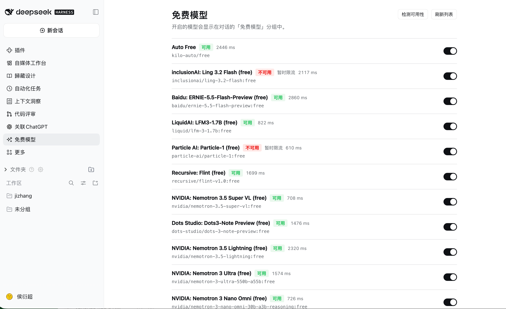
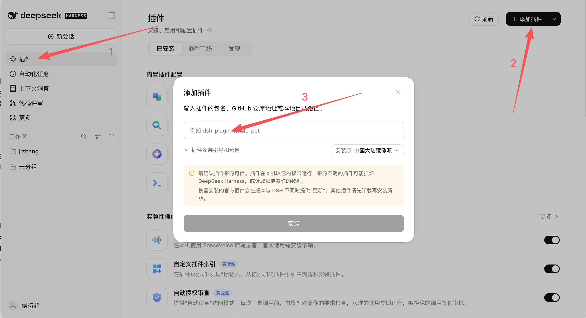

<div align="center">

# dsh-open-model

**A free model plugin for [DeepSeek Harness](https://www.deepseek.com/harness/)**

Free Kilo models · ChatGPT plan access · Model filters and speed tests

[](https://www.deepseek.com/harness/)
[](./LICENSE)
[](https://github.com/houyanchao/dsh-open-model/pulls)
[](https://github.com/houyanchao/dsh-open-model)

[简体中文](./README.md) | **English**



</div>

## 📖 What is dsh-open-model?

Open Model lets you use Kilo’s free models in DeepSeek Harness. You can also sign in to your ChatGPT account to use your plan allowance.

## ✨ Features

Open **OpenModel** in the sidebar and choose **Free models** or **ChatGPT**. The plugin lists the models in `models.json` in the order configured, then checks their availability with the selected provider.

- **Free models** — You can use models in Kilo’s free catalog without an account or API key. Your conversations are sent to Kilo, which sets the anonymous usage limits. A model stays on the management page but appears dimmed if Kilo removes it, its offer expires, it becomes a paid model, or the plugin temporarily cannot verify its availability.
- **ChatGPT** — Use the allowance included in your existing plan. When you’re signed out, the details page shows only the sign-in option. Open DSH locally on macOS or Windows, choose **Continue with ChatGPT**, sign in through your browser, then return to DSH. You can now see the configured models. Authorize access to your plan allowance to enable the available ones. Models appear dimmed if your plan does not include them or their availability cannot be verified. Switching accounts checks the models against the new account’s plan.

## 📦 Installation

### Method 1 (desktop client)

In the [DeepSeek Harness](https://www.deepseek.com/harness/) client, open **Plugins → Add plugin**, enter `dsh-open-model`, then click **Install**.



### Method 2 (install from npm with the CLI)

```bash
# Install dsh-open-model
dsh plugin --profile web add dsh-open-model
```

### Migrating from the old package

If you installed `@houyanchao/dsh-free-model`, run `dsh plugin --profile web remove @houyanchao/dsh-free-model` before installing the new package. Existing conversations keep their model IDs, and your local model visibility settings carry over.

## ⚙️ Managing models

Search by name or model ID, or filter the list by **Enabled**, **Hidden**, or **Unavailable**. Available models are enabled by default. A model appears in the chat picker when it is both available and enabled. Hiding it leaves existing conversations on their selected model. Kilo saves visibility settings per DSH profile. ChatGPT saves them per account.

Turn on **Web search** in the composer to let the model search when needed. The setting is saved per conversation and carries over when you switch between the OpenModel groups for ChatGPT and free models. ChatGPT can use the search included in your plan. Free models need tool-calling support and a search service available in the current DSH session. With web search turned off, DSH can still open links you provide using its web-reading tool.

After choosing an OpenModel free model in the chat, click the model button again. If the model supports reasoning controls, **Reasoning effort** lets you choose one of its supported levels or toggle thinking on or off.

On the **Free models** tab, **Speed test** sends a fixed text request from your DSH instance to each model verified against the catalog. A normal text response marks the model **Available**. A failed request marks it **Unavailable** and shows the reason. The test reports response time in milliseconds and flags requests that time out. The result describes that run. You can still change the model’s visibility independently. Test requests count toward [Kilo’s anonymous usage limits](https://kilo.ai/docs/gateway/authentication#anonymous-access).

The plugin checks the `latest` version on npm. Once a newer version has been published for at least 24 hours, **Update** appears beside **OpenModel** in the sidebar and **Update available** appears at the top of the management page. Select **View update** to open the plugin details.

## ⭐ Support

If dsh-open-model is useful to you, give it a 🌟 to help others discover it!

## 📄 License

Copyright © 2026 houyanchao. The author’s plugin code is licensed under [GPL-3.0-or-later](LICENSE).

The ChatGPT sign-in and conversation code was adapted from the independent implementation in `dsh-use-chatgpt`. It calls the Responses API through the OpenAI JavaScript SDK. The plugin retains the DevKit license distributed with the original project. Third-party dependencies retain their respective licenses. [Third-party notices](notices/THIRD_PARTY_NOTICES.md) · [DevKit license](notices/LICENSE)

Users connect their own ChatGPT plans. The sign-in integration must be offered to users free of charge. The ChatGPT logo on the sign-in button uses brand assets supplied by OpenAI. [Sign in with ChatGPT terms](https://openai.com/policies/sign-in-with-chatgpt-terms/) · [OpenAI brand guidelines](https://openai.com/brand/)
