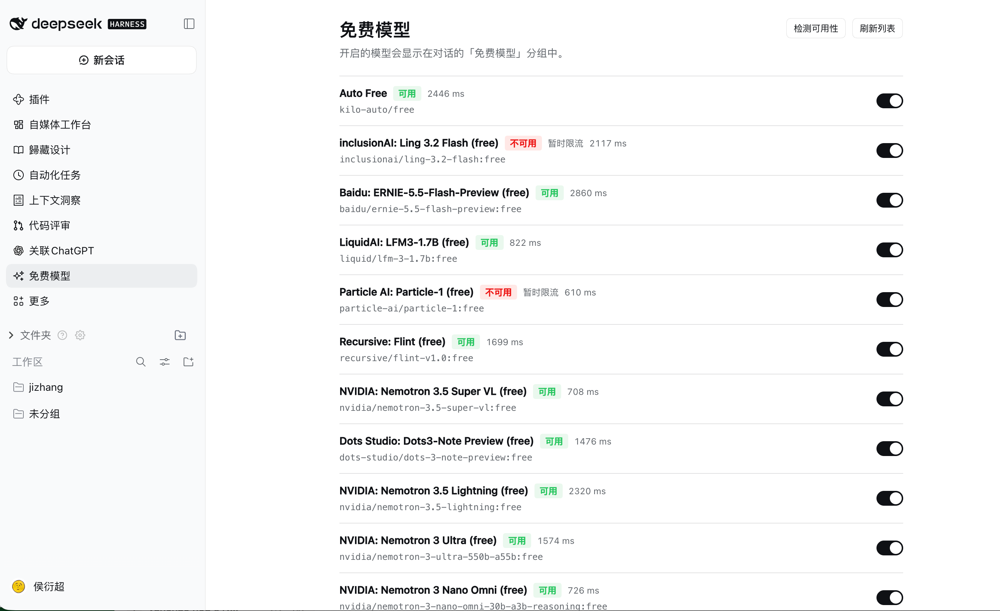

# Open Model

安装后，无需注册或登录，即可在 DSH 中使用免费 AI 模型。连接 ChatGPT 账号后，还能直接使用已有套餐的额度。

插件只列出 Kilo 明确标记为免费且价格为零的文本模型。模型上下线与匿名额度以 Kilo 为准，遇到限流时可以等待后重试。云端推理由 Kilo 提供，对话内容会发往 Kilo。



## 安装

在终端运行以下命令，从 npm 安装插件并启动 DeepSeek Harness。

```bash
dsh plugin --profile web add dsh-open-model
dsh web
```

升级时运行以下命令。

```bash
dsh plugin --profile web update dsh-open-model
```

通过源码运行 DSH 且终端提示 `command not found: dsh` 时，请在 DSH 源码仓库根目录执行上述命令，并将开头的 `dsh` 换成 `pnpm dsh`，例如 `pnpm dsh plugin --profile web add dsh-open-model`。

如果已安装旧包 `@houyanchao/dsh-free-model`，请先运行 `dsh plugin --profile web remove @houyanchao/dsh-free-model`，再安装新包。已有对话的模型标识和本地模型开关设置会沿用。

## 管理模型

打开左侧「免费模型」查看当前的 Kilo 免费模型。模型默认开启。关闭后，它会从新选项中消失，仍可以在管理页重新开启。开关状态按 DSH profile 保存在本机，重新启动后仍然有效。已有会话保留自己选中的模型。

点「检测可用性」会从当前 DSH 的网络出口，给每个模型发一条固定的文本测试请求。收到正常文本回复时标为「可用」，测试失败时标为「不可用」并显示原因。请求耗时以毫秒显示，超过时限则显示「超时」。标签反映该次检测的结果，显示开关仍可单独控制。检测请求计入 [Kilo 匿名请求额度](https://kilo.ai/docs/gateway/authentication#anonymous-access)。

插件会检查 npm 的 `latest` 版本。新版比当前安装版本新且已发布满 24 小时后，侧栏的「免费模型」入口旁会显示「更新」，管理页顶部也会显示「有新版本」。点「查看更新」可打开插件详情。

## 开发

插件无需构建和安装额外依赖，支持文本流和模型目录声明的工具调用能力。管理页面适用于 DSH 的 Web 界面和使用它的桌面客户端。

## 许可证

Copyright © 2026 houyanchao。使用 [GPL-3.0-or-later](LICENSE) 许可证。
